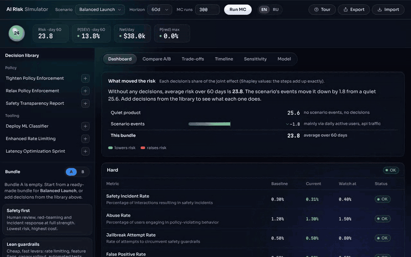
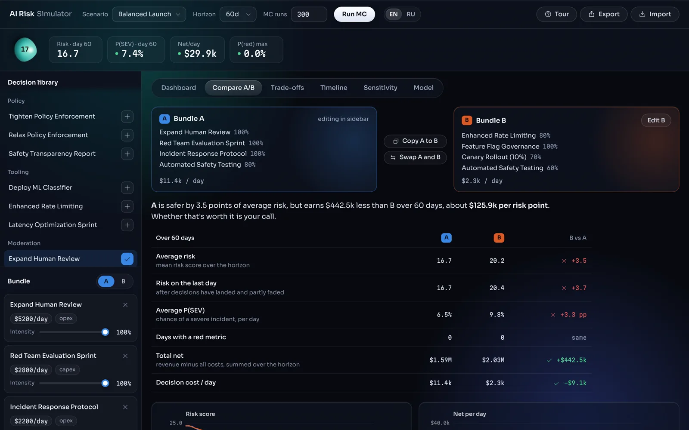
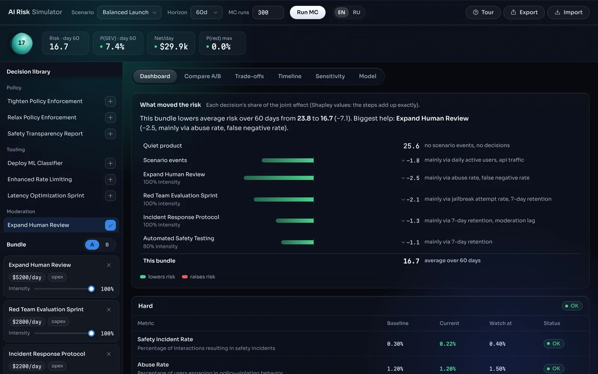
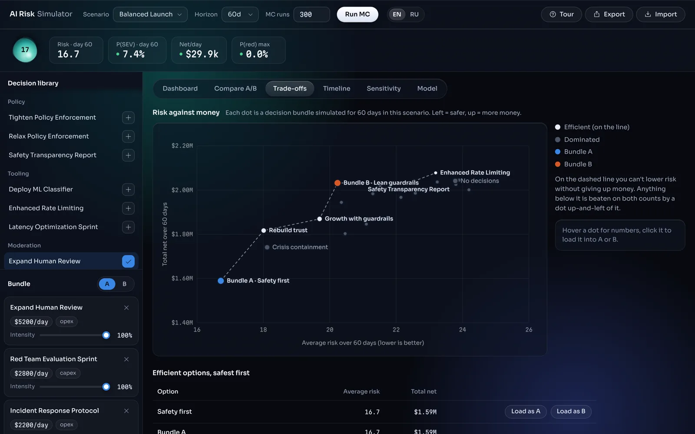
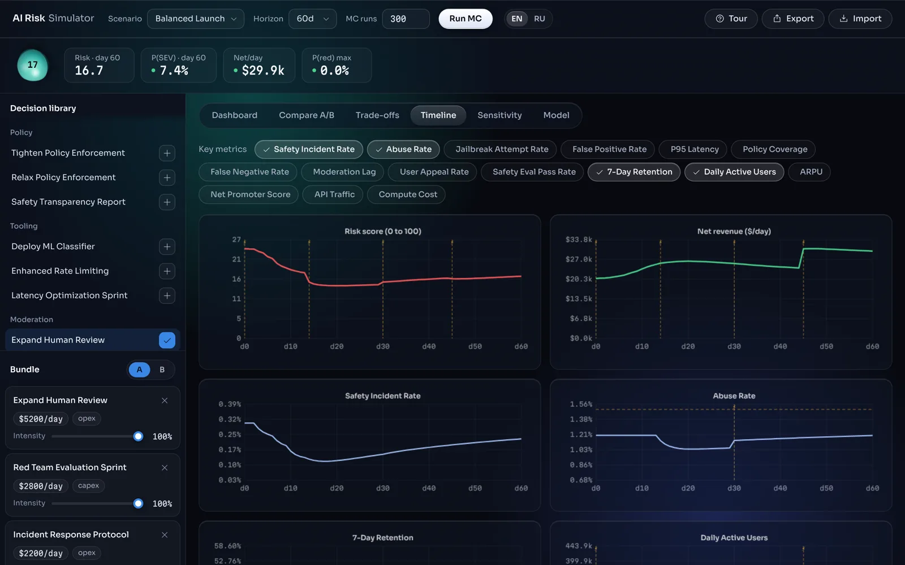

# AI Risk Simulator

**A decision simulator for AI product safety: build two sets of safety measures, see what each does to risk, users and money, and how much every single decision contributed.**

_Симулятор решений по безопасности AI-продукта. Интерфейс на английском и русском, переключатель EN / RU в шапке._

**[Open the simulator →](https://oz-the-magician.github.io/AI-Product-Risk-Simulator-Decision-Support-System-v3/)**



> The model is illustrative. Metrics, guardrails and coefficients are made-up but plausible numbers
> for a consumer AI product. It shows how safety, product and money trade off; it is not calibrated
> on real data.

---

## Case study

### The problem

Safety work on an AI product is a stream of decisions: add human review, ship a classifier, tighten
the policy, slow the rollout. Each one costs money, adds latency or annoys users, and their effects
overlap. In a planning meeting the questions are always the same:

- *If we do these four things instead of those four, how much safer are we, and what does it cost?*
- *Which of the measures actually did the work?*
- *Is there an option that is both cheaper and safer than what we picked?*

Spreadsheets answer one of these at a time and hide the uncertainty. I wanted a tool where a product
manager or a reviewer can try a strategy in a minute and come out with a sentence they can defend.

### Who it is for

- **Product and safety people** who want to compare strategies and see the numbers move.
- **Reviewers of my portfolio** who open it for two minutes; a guided tour walks them through it.

### What I designed

**Two bundles, one comparison.** Everything is built around A versus B. The sidebar edits one bundle
at a time (its controls take that bundle's colour), and the Compare tab ends in a plain-language
verdict: *"A is safer by 3.5 points of average risk, but earns $442.5k less than B over 60 days,
about $125.9k per risk point."*



**What moved the risk.** A waterfall goes from a quiet product, through the scenario's events, to
each decision's share. The shares are Shapley values, so the steps add up exactly instead of leaving
an unexplained "interaction" remainder, and each row names the metrics that carried the effect.



**Risk against money.** Every preset, every single decision and both bundles on one map, with the
Pareto frontier drawn through the efficient options. Anything below the line is beaten on both counts.
Click a dot to load it into A or B.



**Uncertainty you can see.** *Run MC* simulates hundreds of plausible futures (decisions working
better or worse, metrics starting slightly off) in a Web Worker and draws p10 to p90 bands on the
Timeline. The median matches the deterministic run, so the band is about the outcome of your
decisions, not noise around a different answer.



**The look.** Smoked glass over a slow field of light; the only shape that changes is risk itself.
The orb next to the readings re-forms continuously and turns calmer or more agitated with the risk
band. Status is drawn with shape plus label (dot OK, diamond Watch, square Breach), never colour
alone. Details in [`DESIGN.md`](DESIGN.md).

### Decisions and trade-offs

| Decision | Why |
| --- | --- |
| Decisions move a metric's *target level*, not a daily multiplier | Multipliers compounded into runaway curves; levels settle at an equilibrium and stay at baseline when nothing happens |
| Shapley attribution instead of leave-one-out | Leave-one-out left a large unexplained remainder when measures overlapped |
| Risk scored from guardrail stress, power mean (p = 3) | The worst metrics should dominate the score; baseline ≈ 25, all-yellow ≈ 58, all-red = 100 |
| Monte Carlo scored from each run's own start | Otherwise the p50 line drifted away from the deterministic run and the band misled |
| Plain-sentence verdicts next to every chart | The audience needs a sentence to take into a meeting, not a chart to interpret |
| Guided tour with a dimmed screen | A first-time visitor sees 6 tabs and 15 decisions; 11 short steps make it readable in a minute |
| No build step, vanilla ES modules | It runs from GitHub Pages and opens instantly |

### What I'd do next

- Calibrate the coefficients on real incident and moderation data.
- Let teams add their own decisions and metrics from a form instead of editing data files.
- Share a scenario by link, like the mortgage calculator does.

---

## Features

- **Time-based simulation**: day by day, with effect lags and half-life decay
- **Monte Carlo**: 100 to 2000 runs in a Web Worker with p10/p50/p90 bands, cancellable
- **Causal graph**: metrics influence each other through elasticity edges
- **Two bundles, A and B**, with presets per scenario
- **Compare A/B**, **What moved the risk** (Shapley), **Trade-off map** (Pareto frontier)
- **Sensitivity**: one-at-a-time curves and a tornado chart
- **Model tab**: every metric, edge and formula in the open
- **Guided tour**, 11 steps; replay from **Tour** in the header (→ next, ← back, Esc to leave)
- **Export / Import** of the whole setup as JSON
- **English and Russian**; the first visit follows the browser language

## How to run

```bash
python3 -m http.server 8080   # or: npx serve .
```

Open `http://localhost:8080`. A server is required (ES modules do not load from `file://`).

```bash
npm test   # Node 18+, no dependencies
```

The tests check that the model behaves sensibly: no drift without decisions, decisions move metrics
the documented way and fade out, NPS effects are points, decisions cost money, no scenario saturates,
the Monte Carlo median matches the deterministic run, the explanation adds up and the frontier is correct.

## Project structure

```
index.html, styles.css, app.js   shell, look, state and wiring
data/     metrics, decisions, scenarios, priors, presets
engine/   simulator, causal transitions, risk, economics, Monte Carlo (+ worker), analysis (Shapley, Pareto)
ui/       one renderer per tab, SVG chart kit, tour, i18n, icons, formatters
fonts/    Sora and Martian Mono (OFL), self-hosted
tests/    model and analysis tests (node --test)
docs/     screenshots and the demo GIF
```

## Model in brief

- **Levels, not multipliers.** A decision shifts a metric's target; the metric moves 35 % of the gap per day. Effects start after `lagDays` and fade with `halfLifeDays`.
- **Relative and absolute effects.** `+0.18` on a rate means +18 %; NPS levers are points.
- **Causal edges as elasticities.** 10 % above reference in a parent shifts the child's target by `k × 10 %`.
- **Risk from guardrails.** Each metric's stress runs from 0 (green threshold) to 1 (red threshold); a power mean makes the worst dominate, red breaches add a penalty.
- **SEV probability.** A sigmoid of weighted stress of incident, abuse, jailbreak and false-negative rates; the scenario's sensitivity scales the odds.
- **Decisions cost money**: `amountPerDay × intensity`, every day.

The **Model** tab in the app lists every metric, edge and formula.

## Credits

Icons: [Phosphor](https://phosphoricons.com) (MIT). Fonts: Sora and Martian Mono (SIL Open Font License, see `fonts/`).
